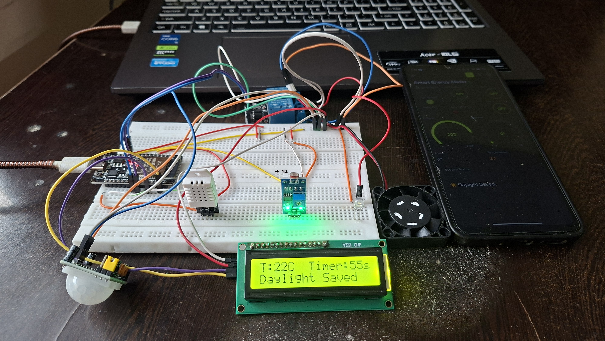
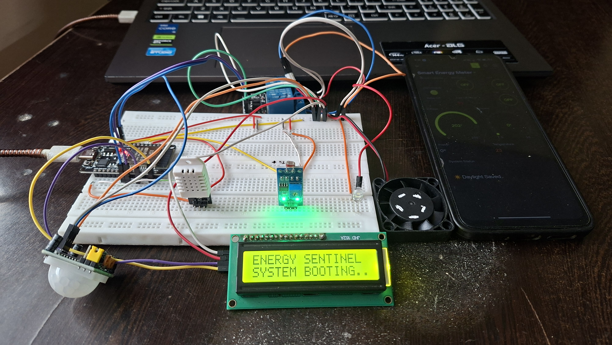
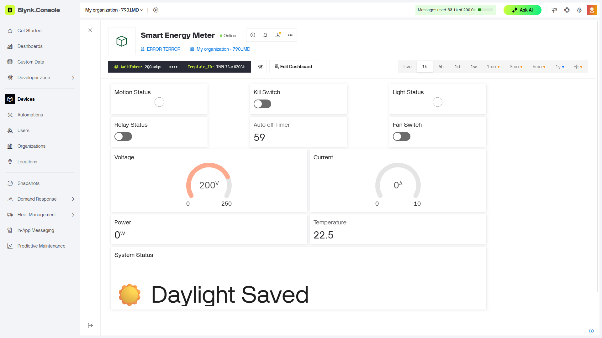
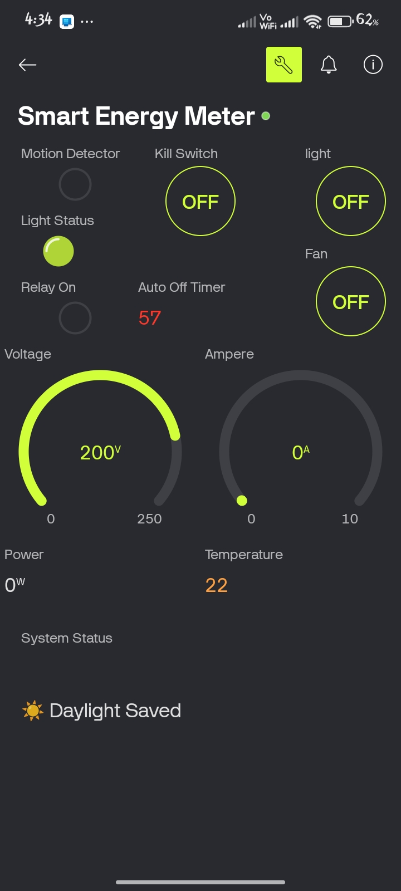

# ⚡ The Energy Sentinel

**Team:** Error Terror  
**Team Members:** Amit Vishwakarma, Ayush Aryan, Atul Pachauri, Jogesh Kumar  

## 🚀 Overview
The Energy Sentinel is an ESP32-based Smart Energy Monitoring and Automation System. It tracks real-time Voltage, Current, and Power via Blynk IoT while automating room lighting and cooling to eliminate electricity wastage.

## ✨ Key Features
- **Live Energy Monitoring:** Real-time Voltage, Current, and Power tracking on Blynk Web & Mobile dashboards.
- **Smart Lighting:** Automatically turns ON light only when both motion (PIR) and darkness (LDR) are detected; saves energy during daylight.
- **Smart Cooling:** Automatically triggers the cooling fan when temperature exceeds 30°C (DHT22).
- **Local Display:** 16x2 I2C LCD showing live temperature, 60-second auto-off countdown timer, and system status.
- **Dual Override & Safety:** Physical push-button overrides plus a remote **Emergency Kill Switch** on Blynk.

## 🛠️ Hardware Components
- **Microcontroller:** ESP32 (30-pin)
- **Sensors:** DHT22 (Temperature), PIR (Motion), LDR (Light)
- **Actuators:** 2-Channel 5V Relay Module (Light & Fan)
- **Display:** 16x2 I2C LCD (`0x27`)
- **Measurement Simulation:** B10K Potentiometers (Voltage & Current)

## 🔌 Pin Connections
| Component | ESP32 Pin |
| :--- | :--- |
| PIR Motion Sensor | GPIO 13 |
| DHT22 Sensor | GPIO 32 |
| LDR Module | GPIO 33 |
| Voltage Sensor (Pot) | GPIO 34 |
| Current Sensor (Pot) | GPIO 35 |
| Light Relay | GPIO 5 |
| Fan Relay | GPIO 18 |
| Physical Light Switch | GPIO 4 |
| Physical Fan Switch | GPIO 26 |
| I2C LCD (SDA / SCL) | GPIO 21 / GPIO 22 |

## 📚 Required Arduino Libraries
- `Blynk` (by Volodymyr Shymanskyy)
- `DHT sensor library` (by Adafruit)
- `LiquidCrystal_I2C`

## 📸 Project Preview

### Live Hardware Setup

### System Booting

### Blynk Web Dashboard

### Blynk Mobile App

